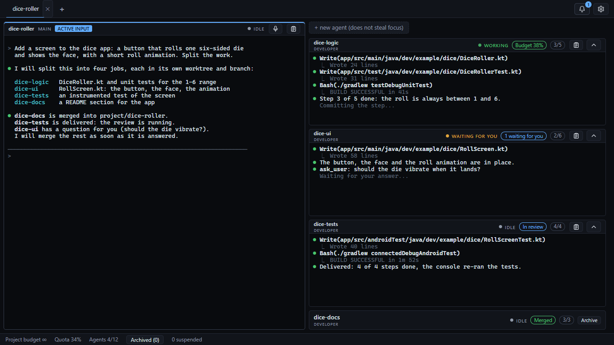
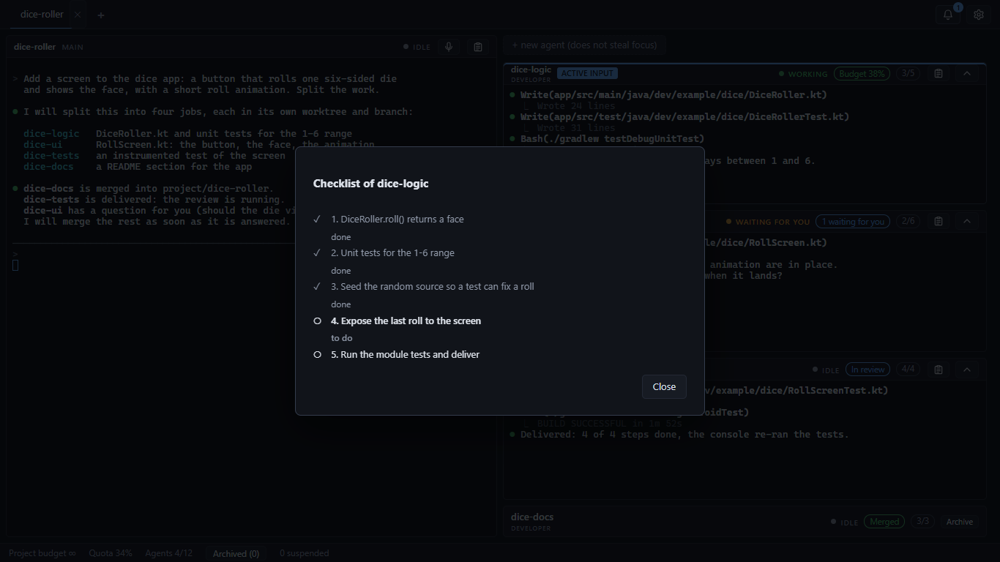
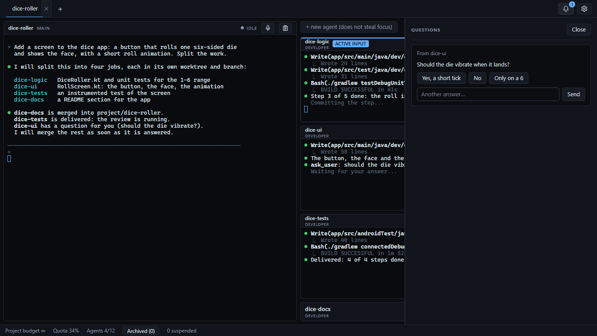
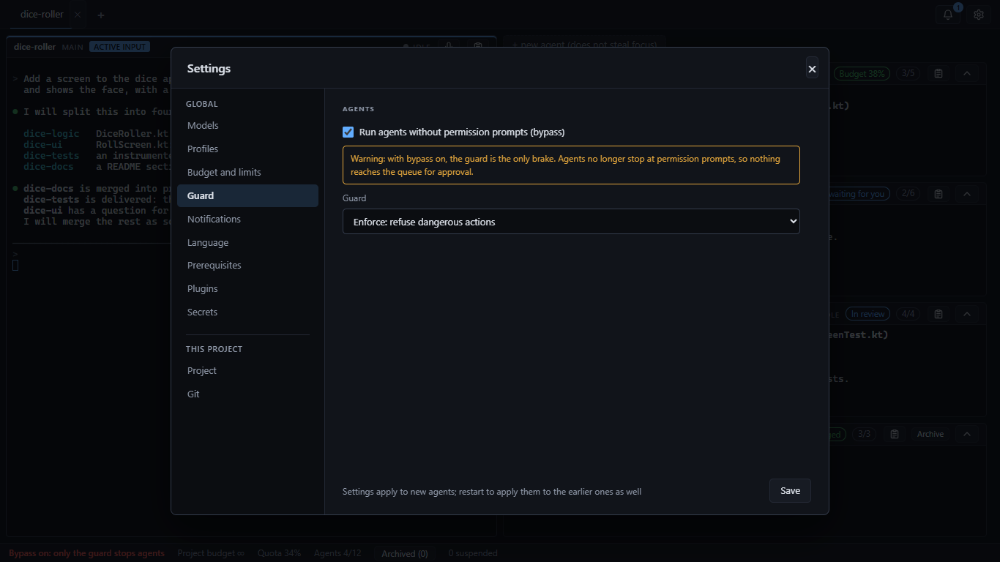

# AndromedaConsole

**Run several Claude Code agents safely: isolated worktrees, budgets, review and controlled merges.**

AndromedaConsole is a local web console for [Claude Code](https://docs.claude.com/en/docs/claude-code). On the left it shows a fixed **main** session you talk to. On the right it shows the **agents** the main starts for you: each one a real `claude` terminal, working in its own git worktree on its own branch, with a ticket, a token budget and a review before anything is merged. You stay in charge: agents never push to `main`, never touch each other's files, and anything that needs a human decision lands in one queue.

> The repository used to be called `multiconsole` (the old links redirect); your local folder may still carry that name.



*A demo project (an Android dice app). The agents' screens in the pictures are staged, not a real run.*

## Why

One coding agent can handle a task. Several at once create a different job: who is working, who is waiting for an answer, who is stuck, what it all costs, and whose changes may be merged. AndromedaConsole makes that job visible and safe:

- **See everything.** Real terminals (xterm.js) side by side, with a state dot for each agent (working, waiting for you, idle, blocked, dormant...).
- **Isolation by default.** Every agent gets `<project>/.andromedaconsole/worktrees/<name>` on the branch `agent/<project>/<name>`; the console commits each checklist step, runs your tests and pushes only that branch.
- **One place to answer.** Questions from agents reach you through the main, so you can answer from the Claude app over Remote Control when you are away. Merge decisions, budget decisions and the release confirmation arrive in the console's queue drawer, with desktop notifications.
- **A brake that is not the model's good intentions.** A guard checks every file and shell tool call against explicit rules before it runs.
- **Cost under control.** Per-agent token budgets, loop detection and subscription-limit handling (sleep until the window resets, wake only the main).
- **Closing the tab is safe.** The server owns every process; the browser only displays. A restart brings the main and the agents back.



*The progress chip of an agent (here 3/5) opens the checklist it is keeping; the console commits each finished step.*



### Why not just open several terminals, or use Claude Code's own features?

- **A terminal does not know about the others.** Here an agent has its own worktree and branch, so two agents cannot overwrite each other, and only the console commits, tests and pushes. With plain terminals that discipline is yours to keep.
- **Nothing merges on a hope.** A ticket is delivered, its tests are re-run on that exact commit, a read-only reviewer reads the diff, and only then is it merged; reaching your real `main` takes one confirmation from you.
- **Money and stuck agents are watched.** Token budgets per agent, loop detection and the subscription limit are handled for you, and every question lands in one queue instead of a tab you forgot to look at.

## What you need

- **Windows 10 or 11, and only Windows.** AndromedaConsole is built for Windows on purpose: the terminals use ConPTY, the guard understands Windows and PowerShell commands and paths, notifications are native Windows toasts and the folder picker is a native window. There is no support for macOS or Linux, and none is planned.
- **Node.js 22 or newer** and **git**.
- **Claude Code** (`claude`) installed and logged in. Open the folder you will work on once with `claude` so you have accepted its workspace-trust dialog.

`npm run console -- doctor` checks these prerequisites and the security setup, and warns about a Claude Code newer than the last one tried.

## Quick start

```bash
git clone https://github.com/FedericoMantovani89/andromedaconsole.git
cd andromedaconsole
npm ci
npm run build
npm run console -- serve
```

On Windows you can double-click `start-console.bat` instead; it installs and builds on first run. The command prints a URL with a single-use code, for example `http://127.0.0.1:7391/?code=...`, and opens it in your browser: the page swaps the code for its login and removes it from the address, so the printed URL opens nothing a second time. The port is fixed on purpose (7391); use `--port` to change it.

There is also a **desktop app** for Windows x64 (an installer on the GitHub releases): the same console in its own window, which checks the releases for a newer version. See [guide/desktop-app.md](guide/desktop-app.md).

## Safety

The server listens on `127.0.0.1` only. A guard denies force pushes, writes outside the agent's worktree (redirects, copies, downloads and clones included), secrets (also by a name with wildcards, such as `.env*`), tampering with the push hook and remotes, and wide `rm`, among others; reviewers and recovery agents are read-only. `agents.bypassPermissions` is **off by default**, and with it on the guard is the only brake (a red chip in the status bar says so). The guard reads command text: it does not stop obfuscated commands, and there is no operating-system sandbox. Telemetry is off; nothing leaves your machine except what Claude Code itself sends and, only if you use voice dictation, the audio you record, which goes to Groq for transcription. Read [SECURITY.md](SECURITY.md) for what is and is not guaranteed.



## Documentation

| | |
|---|---|
| [guide/using.md](guide/using.md) | Opening a project, the main, agents, answering, review and merge, voice dictation, keyboard shortcuts |
| [guide/architecture.md](guide/architecture.md) | How it works and the project layout |
| [guide/configuration.md](guide/configuration.md) | The Options dialog and the config file |
| [guide/desktop-app.md](guide/desktop-app.md) | The Windows app and its releases |
| [guide/development.md](guide/development.md) | Tests, checks and the rules for a change; see also [CONTRIBUTING.md](CONTRIBUTING.md) |
| [SECURITY.md](SECURITY.md) | The threat model and how to report a problem |
| [CHANGELOG.md](CHANGELOG.md) | What changed in each version |

## Status

The console base, the mod channel, git worktrees and tickets, review and merge, budget and limits, and multiple projects with resume, notifications and templates are built and covered by tests and browser acceptance runs with fake agents. The channel between the console and real Claude Code sessions (the main starting agents, goals, questions, permissions) passes a contract run with the real `claude`. The git-worktree, review and merge, budget, quota-sleep and restart flows have not yet had a long run against the real Claude Code, so expect rough edges there. External providers (other coding agents) are planned as an optional next phase.

## License

[MIT](LICENSE) © 2026 Federico Mantovani
